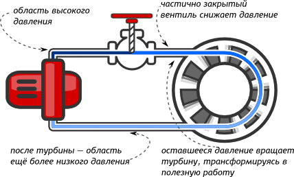
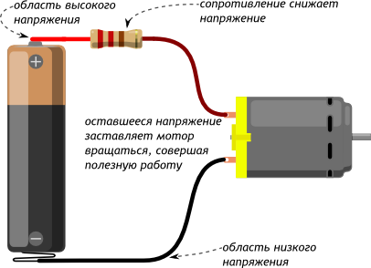

## Понятие электрической цепи

Поведение электрической цепи можно сравнить с гидравлической системой:

Аналогично работают и электрические цепи. 

## Электрический ток

Электрический ток — направленное движение электрических зарядов. Силу тока обозначают буквой `I` и измеряют в амперах `(А)`.
Сама сила тока - это скорость с которой двигаются заряды (электроны) внутри электрической цепи.

Ток, как и давление жидкости, существует только в замкнутой цепи. Если проводник разорван, заряды не могут пройти полный путь
от источника через нагрузку и обратно.

## Напряжение

Напряжение — разность электрических потенциалов между двумя точками. Напряжение обозначают буквой `U` и измеряют в вольтах `(В)`.
Так как напряжение это разность потенциалов (разность между двумя произвольными точками на схеме), то стоит сказать, что за опорную точку (один из потенциалов) в большинстве случаев
выбирается один из выводов источника питания и его потенциал принимается равным нулю.

Например если взять за пример схему из рисунка выше, то за нулевую точку взят `минус` батарейки (ее черная сторона), и именно относительно её, на положительном
выводе батарейки (красном) напряжение будет `1.5В`. В точке между резистором и мотором напряжение будет ниже, из за падения напряжения 
на резисторе (об этом в следующих главах).

У большинства микроконтроллеров рабочий логический уровень составляет 3,3 В. 
Подача более высокого напряжения непосредственно на вывод может повредить микроконтроллер.

## Сопротивление

Электрическое сопротивление показывает, насколько элемент препятствует прохождению тока. Сопротивление обозначают буквой `R` и измеряют в омах (Ом).

Чем больше сопротивление при неизменном напряжении, тем меньше сила тока в цепи.

<Warning>
Не подключайте нагрузку между выводом питания и общим проводом, если её сопротивление неизвестно. Слишком большой ток может повредить нагрузку или источник питания.
</Warning>
