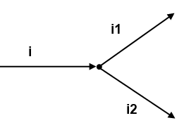
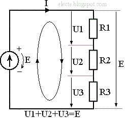

## Закон Ома

Первый и самый основной закон - закон Ома.

Он связывает три важнейшие величины в электротехнике: Силу тока, напряжение и сопротивление.
$$
    I = U / R,
$$
где `I` — сила тока, А;

    `U` — напряжение, В;

    `R` — электрическое сопротивление, Ом.

 Из этой зависимости можно получить ещё две формы:
$$
    U = I · R,
$$
$$
    R = U / I.
$$

<Info>
При напряжении 3,3 В и сопротивлении 330 Ом сила тока составляет:

    I = 3,3 / 330 = 0,01 А = 10 мА.

</Info>

Эта формула используется, например, при выборе резистора для светодиода.

## Мощность

Мощность - мера скорости трансформации электрической энергии в другую форму (например в тепло).

$$
    P = I · U
$$

Зная закон Ома, мощность можно найти и другими способами

$$
    P = U^2 / R = I^2 · R
$$

## Короткое замыкание

При замыкании плюса и минуса источника питания проводником с бесконечно малым сопротивлением (перемычкой в виде провода), исходя из закона Ома
в этом образовавшемся контуре будет протекать бесконечно большой ток. А это, в свою очередь, приводит уже и к бесконечно большому выделению мощности (тепла), которая приведет к возгоранию или выходу из строя компонентов схемы.

# Первый и второй законы Кирхгофа

Первый закон Кирхгофа гласит о том, что сумма токов, втекающих в узел (место соединения двух или более проводников), равна сумме вытекабщих из узла токов.

Этот закон проще понять если вспомнить, что ток это движение зарядов по проводникам. Сколько заряженных частиц втекло в узел, столько и выйдет из него, никто никуда не исчезнет и не возьмется из воздуха.

Второй закон Кирхгофа гласит о том, что сумма всех падений напряжения в контуре равна сумме истоников питания в контуре.

## Последовательное соединение компонентов

## Параллельное соединение компонентов

